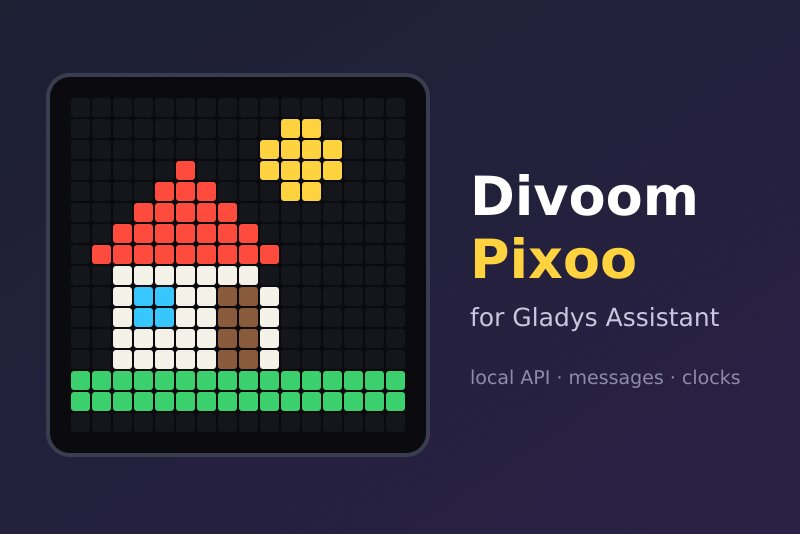
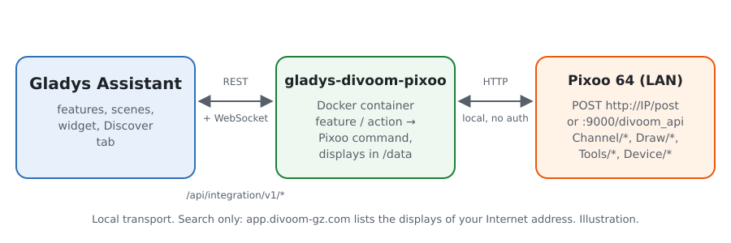
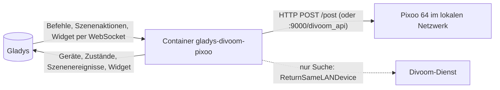
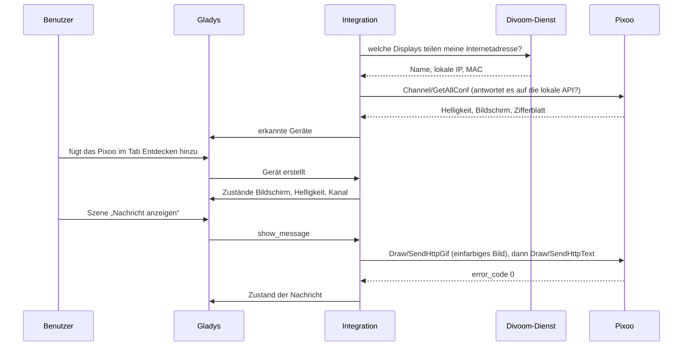
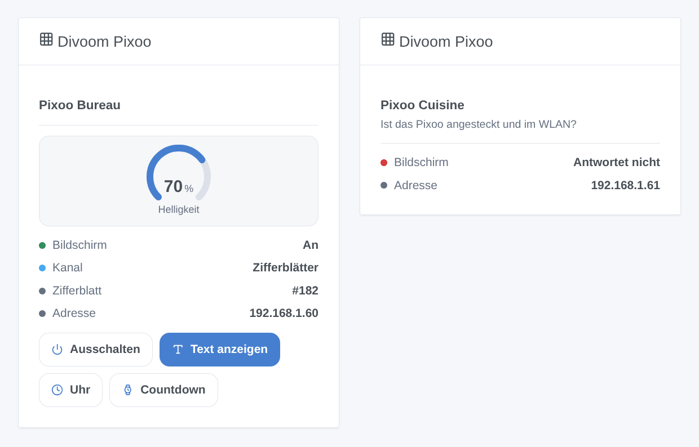

# Gladys Divoom Pixoo

[English](README.md) · [Français](README.fr.md) · **Deutsch** · [Español](README.es.md)

[](LICENSE)
[](https://github.com/William-De71/gladys-divoom-pixoo/releases)
[](https://github.com/William-De71/gladys-divoom-pixoo/actions/workflows/release.yml)
[](https://gladysassistant.com)



Externe Integration für [Gladys Assistant](https://gladysassistant.com) für das Pixel-Display **Divoom Pixoo 64**, über seine offizielle lokale API. Schalte den Bildschirm und seine Helligkeit aus Gladys, zeige Nachrichten, GIFs, Zifferblätter und die Tools des Pixoo aus deinen Szenen und behalte es im Dashboard im Blick.

Benutzerdokumentation: [English](docs/en.md) · [Français](docs/fr.md) · [Deutsch](docs/de.md) · [Español](docs/es.md).

Nicht mit Divoom verbunden. **Noch nicht an einem echten Pixoo getestet**: Die Anfragen folgen der [offiziellen Dokumentation der Divoom-API](http://doc.divoom-gz.com/web/#/12), und die Tests laufen gegen simulierte Displays. Rückmeldungen sind willkommen.

## Funktionen

- **Ein Gladys-Gerät pro Pixoo**: Bildschirm an/aus und Helligkeit (Kategorie Licht, daher in Szenen „Licht aus“ enthalten), Kanal (Zifferblätter, Cloud-Galerie, Visualizer, benutzerdefiniert) und ein im Dashboard eingegebener Text auf dem Bildschirm.
- **Zustände zurückgelesen** alle 10, 30 oder 60 Sekunden: Eine Änderung in der Divoom-App oder am Gerät erscheint in Gladys.
- **8 Szenenaktionen**: Nachricht anzeigen (eine oder zwei Zeilen, Farben, Hintergrund, Laufgeschwindigkeit, Dauer, danach zurück zur vorherigen Anzeige), GIF von einer Adresse abspielen, Zifferblatt anzeigen, Countdown, Stoppuhr, Anzeigetafel, Lärmmesser, Summer.
- **2 Szenenauslöser**: Ein Pixoo antwortet nicht mehr, antwortet wieder.
- **Dashboard-Widget**: Zustand, Kanal, Nummer des Zifferblatts, Helligkeit und Tasten für Bildschirm, Text, Uhr und Countdown.
- **Erkennung** über den offiziellen Divoom-Dienst „Find device“ (optional) oder eingegebene IP-Adressen; ein Display wird über seine MAC-Adresse verfolgt, wenn sich seine IP ändert.
- Vier Sprachen: Englisch, Französisch, Deutsch, Spanisch.

## Funktionsweise





Von der Suche bis zu einem Befehl:



Das Pixoo stürzt ab, wenn es mehrere Anfragen gleichzeitig erhält: Die Anfragen an ein Display werden nacheinander gestellt. Die Bild-IDs von `Draw/SendHttpGif` beginnen über 32 wieder bei 1, weil die Firmware hängen bleibt, wenn sie wachsen.

### Transport

`transports: ["local"]`: Jeder Befehl und jeder Zustand läuft per HTTP im lokalen Netzwerk. Das Gladys-Badge jedes Geräts zeigt **lokal**, oder **nicht erreichbar**, wenn das Pixoo nicht mehr antwortet. Ist die Divoom-Suche eingeschaltet, fragt die Integration `https://app.divoom-gz.com/Device/ReturnSameLANDevice` (kein Konto, außer der Anfrage werden keine Daten gesendet) nach den Displays, die von deiner Internetadresse aus gesehen werden, wie es die Divoom-App tut; schalte sie aus, um nur eingegebene Adressen zu nutzen.

## Geräte und Funktionen

| Funktion   | Kategorie / Typ        | Werte                                    | Zurückgelesen |
| ---------- | ---------------------- | ---------------------------------------- | ------------- |
| Bildschirm | `light` / `binary`     | 0 aus, 1 an                              | ja            |
| Helligkeit | `light` / `brightness` | 0 bis 100                                | ja            |
| Kanal      | `text` / `select`      | `faces`, `cloud`, `visualizer`, `custom` | ja            |
| Nachricht  | `text` / `text`        | der letzte aus Gladys gesendete Text     | nein          |

## Szenen und Widget

| Art      | Schlüssel         | Verwendung                                                                 |
| -------- | ----------------- | -------------------------------------------------------------------------- |
| Aktion   | `show_message`    | eine oder zwei Zeilen, Farbe, Hintergrund, Laufgeschwindigkeit, Dauer      |
| Aktion   | `play_gif`        | ein GIF mit 16, 32 oder 64 Pixel Breite, vom Pixoo geladen                 |
| Aktion   | `show_clock_face` | ein Zifferblatt über seine Nummer (im Widget angezeigt), oder das aktuelle |
| Aktion   | `countdown`       | Countdown starten oder stoppen (Minuten, Sekunden)                         |
| Aktion   | `stopwatch`       | Stoppuhr starten, stoppen oder zurücksetzen                                |
| Aktion   | `scoreboard`      | blaue und rote Punkte, 0 bis 999                                           |
| Aktion   | `noise_meter`     | Lärmmesser starten oder stoppen                                            |
| Aktion   | `play_buzzer`     | bis zu 10 Sekunden summen                                                  |
| Auslöser | `unreachable`     | ein Pixoo antwortet zweimal hintereinander nicht                           |
| Auslöser | `reachable_again` | es antwortet wieder                                                        |
| Widget   | `pixoo`           | ein Display: Zustand, Kanal, Helligkeit, vier Tasten                       |

Beispiele: Wenn der Briefkasten öffnet, 60 Sekunden lang „Post ist da“ in Gelb anzeigen; jeden Abend um 23 Uhr den Bildschirm ausschalten; wenn die Waschmaschine fertig ist, eine Nachricht auf dunkelblauem Hintergrund zeigen und eine Sekunde summen.



## Voraussetzungen

- Gladys Assistant **5.3.0** oder neuer (ältere Versionen können die Integration nicht installieren).
- Ein Divoom Pixoo 64, eingerichtet mit der Divoom-App, im Netzwerk von Gladys, mit aktueller Firmware. Andere WLAN-Displays von Divoom (Pixoo 16, Pixoo Max, Times Gate) können teilweise funktionieren; die Bluetooth-Lautsprecher (Ditoo, Tivoo…) haben keine lokale API und werden ausgelassen.

## Installation

- **Aus dem Store**: Integrationen → Divoom Pixoo → Installieren.
- **Über die URL des Repositorys**: Integrationen → externe Integration → `https://github.com/William-De71/gladys-divoom-pixoo`.
- **Entwicklermodus**: `npm start` mit den Variablen starten, die Gladys liefert (siehe Entwicklung).

## Konfiguration

| Feld                                   | Standard    | Verwendung                                                          |
| -------------------------------------- | ----------- | ------------------------------------------------------------------- |
| Displays über den Divoom-Dienst finden | an          | fragt den offiziellen Divoom-Dienst nach den Displays deines Netzes |
| IP-Adressen                            | leer        | Displays, die die Suche nicht findet, durch Kommas getrennt         |
| Zustandsaktualisierung                 | 30 Sekunden | 10 s, 30 s oder 1 min                                               |
| Sprache der Gerätetexte                | Englisch    | Funktions- und Kanalnamen, Fehlermeldungen der Szenen               |

Die Taste **Displays suchen und testen** sucht erneut und listet jedes gefundene Pixoo mit Adresse und Helligkeit auf.

## Verwendung

1. Konfigurieren, dann auf **Displays suchen und testen** klicken.
2. Den Tab **Entdecken** öffnen und die Displays hinzufügen.
3. Die Funktionen im Dashboard nutzen, das Widget **Divoom Pixoo** hinzufügen und Szenen mit den Aktionen und Auslösern oben bauen.

## Entwicklung

```bash
npm install
npm test                       # node --test, simulierte Displays, nie das Netzwerk
npm run lint                   # ESLint
npm run format:check           # Prettier
npx github:GladysAssistant/integration-store . --skip-image-check
scripts/build-cover.sh         # cover.jpg aus docs/assets/cover.svg
docs/illustrations/render.sh   # docs/assets/widgets.<Sprache>.png
```

Lokal liest das SDK `GLADYS_HOST_API_URL`, `GLADYS_INTEGRATION_TOKEN` und `GLADYS_INTEGRATION_SELECTOR` (von Gladys im Entwicklermodus geliefert); `PIXOO_DATA_DIR` verlegt `/data`. `DEBUG=gladys-integration-sdk` zeigt die Logs des SDK.

Die Tests decken den HTTP-Client ab (dokumentierte Befehle, der Endpunkt :9000, eine Anfrage nach der anderen), die Divoom-Suche, die Bilder, das Gerät im Tab Entdecken (festgehalten in `test/fixtures/discovery.baseline.json`), das Widget (`validateWidgetContent`), das Manifest, die vier Sprachen, das Release-Skript und die ganze Integration gegen das simulierte Gladys des SDK. `test/structure.test.js` friert jeden Schlüssel ein, den Benutzer speichern.

## Release-Prozess


Jeder Merge auf `main` startet die CI und berechnet dann die Version aus den [Conventional Commits](https://www.conventionalcommits.org/) seit dem letzten Tag: `feat` → Minor, `fix` / `perf` → Patch, `!` oder `BREAKING CHANGE` → Major (unter 1.0.0 ein Minor); `docs`, `chore`, `ci`, `test`, `style`, `refactor`, `build` allein veröffentlichen nichts. Der Changelog-Abschnitt wird erzeugt, der Tag gepusht, das Multi-Architektur-Image gebaut, dann erhält `main` den Release-Commit, das GitHub Release wird erstellt und ein letzter Job prüft das öffentliche Image, den Store-Validator und das Topic.

- Der Titel des Pull Requests wird zum Squash-Commit und dann zur Changelog-Zeile: Schreib ihn auf Englisch, für den Benutzer (`pr-title.yml` prüft ihn). `CHANGELOG.md` nie von Hand bearbeiten.
- 1.0.0 ist eine Entscheidung: Actions → Release → Run workflow mit `release-as: 1.0.0`. `dry-run` zeigt Version und Notizen, ohne zu veröffentlichen.
- **Geschützter Branch**: Das Release pusht seinen Commit mit `GITHUB_TOKEN` auf `main`. Das Ruleset `protect-main` (kein Löschen, kein Force-Push) lässt ihn durch; eine strengere Regel (Pull Request Pflicht, Status Checks) bräuchte GitHub Actions in der Ausnahmeliste oder eine GitHub App.
- Nach dem ersten Release das Paket auf `ghcr.io` öffentlich machen (Package settings → Change visibility), sonst kann Gladys es nicht laden.

## Fehlerbehebung

Siehe [docs/de.md](docs/de.md#fehlerbehebung). Melde Probleme mit den Versionen von Gladys, der Integration und der Pixoo-Firmware sowie der Meldung von **Displays suchen und testen**.

## Mitwirken

Issues und Pull Requests sind willkommen, besonders von Pixoo-Besitzern: das Ergebnis an einem echten Display (was geht, was nicht) hilft sehr. Führe `npm run format:check && npm run lint && npm test` vor einem Pull Request aus und ändere keinen gespeicherten Schlüssel (siehe [CLAUDE.md](CLAUDE.md)).

## Sicherheit

Siehe [SECURITY.md](SECURITY.md): Melde Schwachstellen vertraulich. Die lokale API des Pixoo hat kein Passwort: Halte es in einem vertrauenswürdigen Netzwerk.

## Kommende Bildschirmfotos

Die Bilder oben sind Illustrationen, keine Bildschirmfotos. Echte Bildschirmfotos kommen nach `docs/assets/screenshots/` (PNG, 1280 × 800): `configuration.png` (die Konfiguration mit ihrem Status), `discover.png` (ein Pixoo im Tab Entdecken), `dashboard.png` (die Funktionen und das Widget in einem Dashboard), `pixoo-message.jpg` (ein Foto einer Nachricht auf dem Pixoo).

## Lizenz

[Apache-Lizenz 2.0](LICENSE) — siehe auch [NOTICE](NOTICE). Divoom und Pixoo sind Marken von Divoom; dieses Projekt ist nicht mit Divoom verbunden, von Divoom unterstützt oder gesponsert. Danke an die Dokumentation und das SDK von Gladys, an die offizielle Dokumentation der Divoom-API und an die Home-Assistant-Integration [pixoo-homeassistant](https://github.com/gickowtf/pixoo-homeassistant) für ihre Beobachtungen der Firmware.
