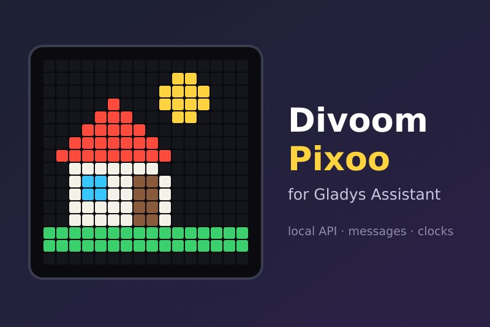
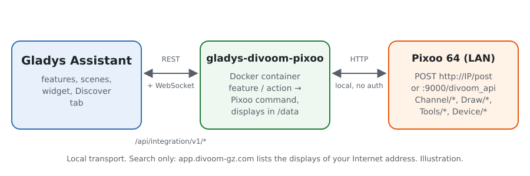
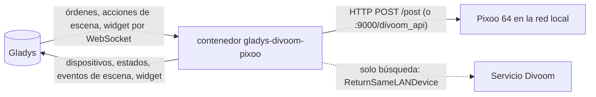
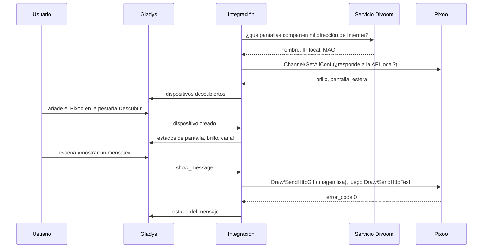
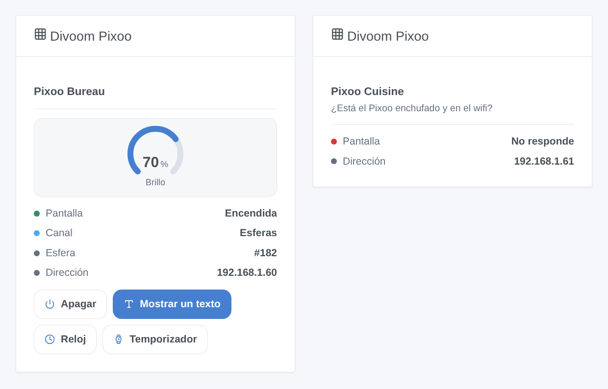

# Gladys Divoom Pixoo

[English](README.md) · [Français](README.fr.md) · [Deutsch](README.de.md) · **Español**

[](LICENSE)
[](https://github.com/William-De71/gladys-divoom-pixoo/releases)
[](https://github.com/William-De71/gladys-divoom-pixoo/actions/workflows/release.yml)
[](https://gladysassistant.com)



Integración externa para [Gladys Assistant](https://gladysassistant.com) de la pantalla de píxeles **Divoom Pixoo 64**, mediante su API local oficial. Encienda la pantalla y ajuste su brillo desde Gladys, muestre mensajes, GIF, esferas y herramientas del Pixoo desde sus escenas, y vigílelo desde el panel.

Documentación de usuario: [English](docs/en.md) · [Français](docs/fr.md) · [Deutsch](docs/de.md) · [Español](docs/es.md).

Sin relación con Divoom. **Todavía no probada con un Pixoo real**: las peticiones siguen la [documentación oficial de la API de Divoom](http://doc.divoom-gz.com/web/#/12) y las pruebas se ejecutan con pantallas simuladas. Se agradecen los comentarios.

## Funciones

- **Un dispositivo de Gladys por Pixoo**: pantalla encendida/apagada y brillo (categoría luz, por lo que se incluye en las escenas «apagar las luces»), canal (esferas, galería en la nube, visualizador, personalizado) y un texto escrito en el panel que aparece en la pantalla.
- **Estados releídos** cada 10, 30 o 60 segundos: un cambio hecho en la app Divoom o en el aparato aparece en Gladys.
- **8 acciones de escena**: mostrar un mensaje (una o dos líneas, colores, fondo, desplazamiento, duración y vuelta a la vista anterior), reproducir un GIF desde una dirección, mostrar una esfera, temporizador, cronómetro, marcador, sonómetro, zumbador.
- **2 desencadenantes de escena**: un Pixoo deja de responder, vuelve a responder.
- **Widget del panel**: estado, canal, número de la esfera, brillo, y botones de pantalla, texto, reloj y temporizador.
- **Descubrimiento** mediante el servicio oficial de Divoom «Find device» (opcional) o direcciones IP escritas; una pantalla se sigue por su dirección MAC cuando cambia su IP.
- Cuatro idiomas: inglés, francés, alemán, español.

## Funcionamiento





De la búsqueda a una orden:



El Pixoo se bloquea si recibe varias peticiones a la vez: las peticiones a una misma pantalla se ponen en cola, una a una. Los identificadores de imagen de `Draw/SendHttpGif` vuelven a 1 por encima de 32, porque el firmware se atasca cuando crecen.

### Transporte

`transports: ["local"]`: cada orden y cada estado van por HTTP en la red local. La insignia de Gladys de cada dispositivo indica **local**, o **inaccesible** cuando el Pixoo deja de responder. Con la búsqueda de Divoom activada, la integración pregunta a `https://app.divoom-gz.com/Device/ReturnSameLANDevice` (sin cuenta, sin enviar datos aparte de la petición) por las pantallas vistas desde su dirección de Internet, como hace la app Divoom; desactívela para usar solo direcciones escritas.

## Dispositivos y funciones

| Función  | Categoría / tipo       | Valores                                  | Releída |
| -------- | ---------------------- | ---------------------------------------- | ------- |
| Pantalla | `light` / `binary`     | 0 apagada, 1 encendida                   | sí      |
| Brillo   | `light` / `brightness` | 0 a 100                                  | sí      |
| Canal    | `text` / `select`      | `faces`, `cloud`, `visualizer`, `custom` | sí      |
| Mensaje  | `text` / `text`        | el último texto enviado desde Gladys     | no      |

## Escenas y widget

| Tipo           | Clave             | Uso                                                             |
| -------------- | ----------------- | --------------------------------------------------------------- |
| Acción         | `show_message`    | una o dos líneas, color, fondo, desplazamiento, duración        |
| Acción         | `play_gif`        | un GIF de 16, 32 o 64 píxeles de ancho, descargado por el Pixoo |
| Acción         | `show_clock_face` | una esfera por su número (mostrado en el widget), o la actual   |
| Acción         | `countdown`       | iniciar o detener el temporizador (minutos, segundos)           |
| Acción         | `stopwatch`       | iniciar, detener o poner a cero el cronómetro                   |
| Acción         | `scoreboard`      | puntuaciones azul y roja, de 0 a 999                            |
| Acción         | `noise_meter`     | iniciar o detener el sonómetro                                  |
| Acción         | `play_buzzer`     | hacer sonar hasta 10 segundos                                   |
| Desencadenante | `unreachable`     | un Pixoo deja de responder dos veces seguidas                   |
| Desencadenante | `reachable_again` | vuelve a responder                                              |
| Widget         | `pixoo`           | una pantalla: estado, canal, brillo, cuatro botones             |

Ejemplos: cuando se abre el buzón, mostrar «Ha llegado el correo» en amarillo durante 60 segundos; cada noche a las 23:00, apagar la pantalla; cuando termina la lavadora, mostrar un mensaje sobre fondo azul oscuro y hacer sonar un segundo.



## Requisitos

- Gladys Assistant **5.3.0** o posterior (las versiones anteriores no pueden instalar la integración).
- Un Divoom Pixoo 64 configurado con la app Divoom, en la red de Gladys, con el firmware al día. Otras pantallas wifi de Divoom (Pixoo 16, Pixoo Max, Times Gate) pueden funcionar en parte; los altavoces Bluetooth (Ditoo, Tivoo…) no tienen API local y se descartan.

## Instalación

- **Desde la tienda**: Integraciones → Divoom Pixoo → Instalar.
- **Desde la URL del repositorio**: Integraciones → integración externa → `https://github.com/William-De71/gladys-divoom-pixoo`.
- **Modo desarrollador**: ejecute `npm start` con las variables que da Gladys (ver Desarrollo).

## Configuración

| Campo                                          | Por defecto | Uso                                                                |
| ---------------------------------------------- | ----------- | ------------------------------------------------------------------ |
| Encontrar las pantallas con el servicio Divoom | activado    | pregunta al servicio oficial de Divoom por las pantallas de su red |
| Direcciones IP                                 | vacío       | pantallas que la búsqueda no encuentra, separadas por comas        |
| Actualización del estado                       | 30 segundos | 10 s, 30 s o 1 min                                                 |
| Idioma de los textos de los dispositivos       | inglés      | nombres de funciones y canales, errores de las escenas             |

El botón **Buscar y probar las pantallas** vuelve a buscar y lista cada Pixoo encontrado con su dirección y su brillo.

## Uso

1. Configure y pulse **Buscar y probar las pantallas**.
2. Abra la pestaña **Descubrir** y añada sus pantallas.
3. Use las funciones en el panel, añada el widget **Divoom Pixoo** y cree escenas con las acciones y desencadenantes de arriba.

## Desarrollo

```bash
npm install
npm test                       # node --test, pantallas simuladas, nunca la red
npm run lint                   # ESLint
npm run format:check           # Prettier
npx github:GladysAssistant/integration-store . --skip-image-check
scripts/build-cover.sh         # cover.jpg desde docs/assets/cover.svg
docs/illustrations/render.sh   # docs/assets/widgets.<idioma>.png
```

En local, el SDK lee `GLADYS_HOST_API_URL`, `GLADYS_INTEGRATION_TOKEN` y `GLADYS_INTEGRATION_SELECTOR` (que da Gladys en modo desarrollador); `PIXOO_DATA_DIR` cambia `/data` de sitio. `DEBUG=gladys-integration-sdk` muestra los registros del SDK.

Las pruebas cubren el cliente HTTP (órdenes documentadas, el punto de acceso :9000, una petición a la vez), la búsqueda de Divoom, las imágenes, el dispositivo de la pestaña Descubrir (fijado en `test/fixtures/discovery.baseline.json`), el widget (`validateWidgetContent`), el manifiesto, los cuatro idiomas, el script de publicación y toda la integración frente al Gladys simulado del SDK. `test/structure.test.js` congela cada clave que guardan los usuarios.

## Proceso de publicación


Cada fusión en `main` lanza la CI y luego calcula la versión a partir de los [Conventional Commits](https://www.conventionalcommits.org/) desde la última etiqueta: `feat` → menor, `fix` / `perf` → parche, `!` o `BREAKING CHANGE` → mayor (una menor por debajo de 1.0.0); `docs`, `chore`, `ci`, `test`, `style`, `refactor`, `build` solos no publican nada. Se genera la sección del changelog, se envía la etiqueta, se construye la imagen multiarquitectura, luego `main` recibe el commit de publicación, se crea la GitHub Release y un último job comprueba la imagen pública, el validador de la tienda y el topic.

- El título de la pull request se convierte en el commit de squash y luego en la línea del changelog: escríbalo en inglés, para el usuario (`pr-title.yml` lo comprueba). No edite nunca `CHANGELOG.md` a mano.
- La 1.0.0 es una decisión: Actions → Release → Run workflow con `release-as: 1.0.0`. `dry-run` muestra la versión y las notas sin publicar.
- **Rama protegida**: la publicación envía su commit a `main` con `GITHUB_TOKEN`. El ruleset `protect-main` (sin borrado, sin force-push) lo deja pasar; una regla más estricta (pull request obligatoria, status checks) necesitaría GitHub Actions en la lista de excepciones, o una GitHub App.
- Tras la primera publicación, haga público el paquete de `ghcr.io` (Package settings → Change visibility); si no, Gladys no puede descargarlo.

## Solución de problemas

Ver [docs/es.md](docs/es.md#solución-de-problemas). Informe de los problemas con las versiones de Gladys, de la integración y del firmware del Pixoo, y el mensaje de **Buscar y probar las pantallas**.

## Contribuir

Las issues y pull requests son bienvenidas, sobre todo de quienes tienen un Pixoo: el resultado con una pantalla real (lo que funciona y lo que no) ayuda mucho. Ejecute `npm run format:check && npm run lint && npm test` antes de abrir una pull request y no cambie ninguna clave guardada (ver [CLAUDE.md](CLAUDE.md)).

## Seguridad

Ver [SECURITY.md](SECURITY.md): informe de las vulnerabilidades en privado. La API local del Pixoo no tiene contraseña: manténgalo en una red de confianza.

## Capturas pendientes

Las imágenes de arriba son ilustraciones, no capturas de pantalla. Las capturas reales irán en `docs/assets/screenshots/` (PNG, 1280 × 800): `configuration.png` (la configuración con su estado), `discover.png` (un Pixoo en la pestaña Descubrir), `dashboard.png` (las funciones y el widget en un panel), `pixoo-message.jpg` (una foto de un mensaje en el Pixoo).

## Licencia

[Licencia Apache 2.0](LICENSE) — ver también [NOTICE](NOTICE). Divoom y Pixoo son marcas de Divoom; este proyecto no está afiliado, respaldado ni patrocinado por Divoom. Gracias a la documentación y al SDK de Gladys, a la documentación oficial de la API de Divoom y a la integración de Home Assistant [pixoo-homeassistant](https://github.com/gickowtf/pixoo-homeassistant) por sus observaciones del firmware.
