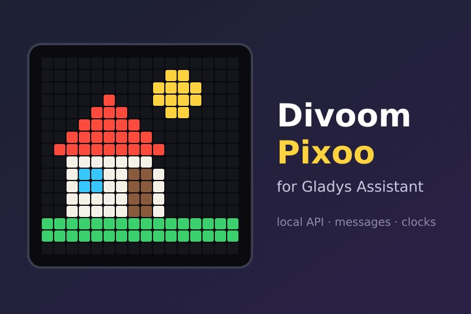
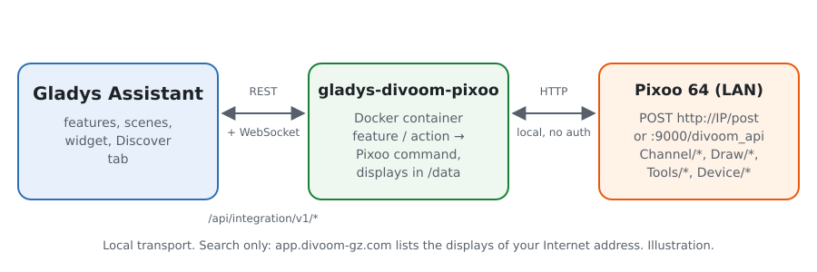
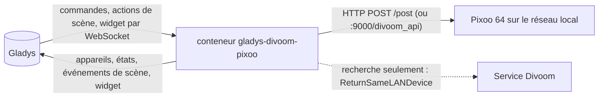
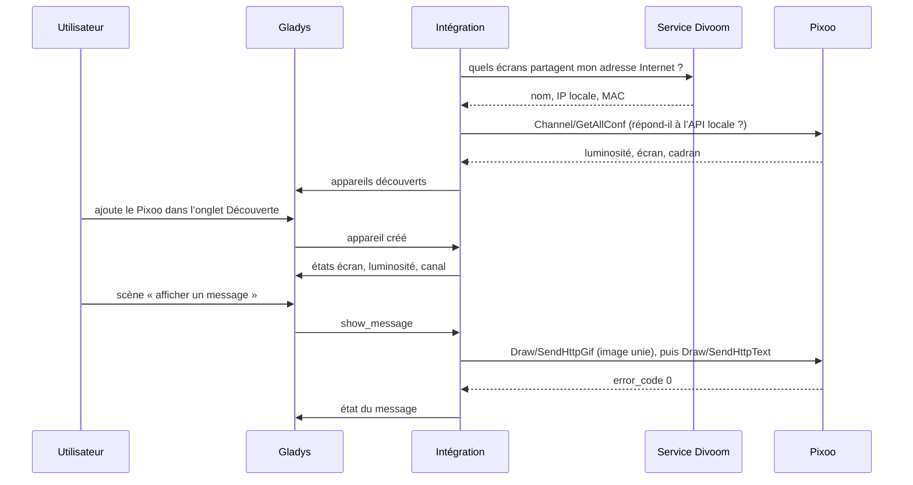
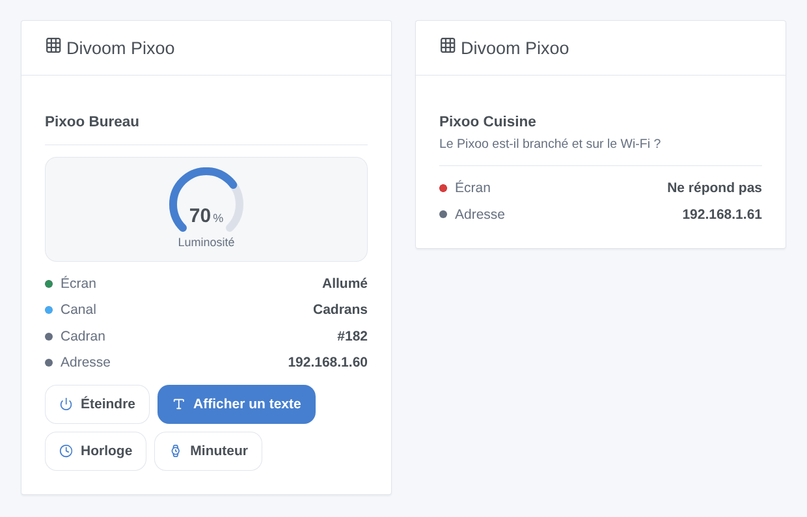

# Gladys Divoom Pixoo

[English](README.md) · **Français** · [Deutsch](README.de.md) · [Español](README.es.md)

[](LICENSE)
[](https://github.com/William-De71/gladys-divoom-pixoo/releases)
[](https://github.com/William-De71/gladys-divoom-pixoo/actions/workflows/release.yml)
[](https://gladysassistant.com)



Intégration externe pour [Gladys Assistant](https://gladysassistant.com) de l’écran à pixels **Divoom Pixoo 64**, par son API locale officielle. Allumez l’écran et réglez sa luminosité depuis Gladys, affichez messages, GIF, cadrans et outils du Pixoo depuis vos scènes, et gardez un œil dessus depuis le tableau de bord.

Documentation utilisateur : [English](docs/en.md) · [Français](docs/fr.md) · [Deutsch](docs/de.md) · [Español](docs/es.md).

Sans lien avec Divoom. **Pas encore testée sur un vrai Pixoo** : les requêtes suivent la [documentation officielle de l’API Divoom](http://doc.divoom-gz.com/web/#/12) et les tests tournent sur des écrans simulés. Vos retours sont les bienvenus.

## Fonctionnalités

- **Un appareil Gladys par Pixoo** : écran allumé/éteint et luminosité (catégorie lumière, donc inclus dans les scènes « éteindre les lumières »), canal (cadrans, galerie cloud, visualiseur, personnalisé) et un texte tapé sur le tableau de bord affiché à l’écran.
- **États relus** toutes les 10, 30 ou 60 secondes : un changement fait dans l’appli Divoom ou sur l’appareil remonte dans Gladys.
- **8 actions de scène** : afficher un message (une ou deux lignes, couleurs, fond, défilement, durée puis retour à l’affichage précédent), lire un GIF depuis une adresse, afficher un cadran, minuteur, chronomètre, tableau des scores, sonomètre, buzzer.
- **2 déclencheurs de scène** : un Pixoo ne répond plus, répond de nouveau.
- **Widget de tableau de bord** : état, canal, numéro du cadran, luminosité, et boutons écran, texte, horloge et minuteur.
- **Découverte** par le service officiel Divoom « Find device » (facultatif) ou par adresses IP saisies ; un écran est suivi par son adresse MAC quand son IP change.
- Quatre langues : anglais, français, allemand, espagnol.

## Fonctionnement





De la recherche à une commande :



Le Pixoo plante s’il reçoit plusieurs requêtes à la fois : les requêtes vers un même écran passent en file, une à la fois. Les identifiants d’image de `Draw/SendHttpGif` repartent de 1 au-delà de 32, car le micrologiciel se bloque quand ils grandissent.

### Transport

`transports: ["local"]` : chaque commande et chaque état passent en HTTP sur le réseau local. Le badge Gladys de chaque appareil indique **local**, ou **injoignable** quand le Pixoo ne répond plus. Quand la recherche Divoom est activée, l’intégration demande à `https://app.divoom-gz.com/Device/ReturnSameLANDevice` (ni compte, aucune donnée envoyée à part la demande) les écrans vus depuis votre adresse Internet, comme le fait l’appli Divoom ; désactivez-la pour n’utiliser que les adresses saisies.

## Appareils et fonctionnalités

| Fonctionnalité | Catégorie / type       | Valeurs                                  | Relue |
| -------------- | ---------------------- | ---------------------------------------- | ----- |
| Écran          | `light` / `binary`     | 0 éteint, 1 allumé                       | oui   |
| Luminosité     | `light` / `brightness` | 0 à 100                                  | oui   |
| Canal          | `text` / `select`      | `faces`, `cloud`, `visualizer`, `custom` | oui   |
| Message        | `text` / `text`        | le dernier texte envoyé depuis Gladys    | non   |

## Scènes et widget

| Type        | Clé               | Usage                                                                |
| ----------- | ----------------- | -------------------------------------------------------------------- |
| Action      | `show_message`    | une ou deux lignes, couleur, fond, défilement, durée                 |
| Action      | `play_gif`        | un GIF de 16, 32 ou 64 pixels de large, téléchargé par le Pixoo      |
| Action      | `show_clock_face` | un cadran par son numéro (affiché dans le widget), ou celui en cours |
| Action      | `countdown`       | lancer ou arrêter le minuteur (minutes, secondes)                    |
| Action      | `stopwatch`       | lancer, arrêter ou remettre à zéro le chronomètre                    |
| Action      | `scoreboard`      | scores bleu et rouge, de 0 à 999                                     |
| Action      | `noise_meter`     | lancer ou arrêter le sonomètre                                       |
| Action      | `play_buzzer`     | faire sonner jusqu’à 10 secondes                                     |
| Déclencheur | `unreachable`     | un Pixoo ne répond plus deux fois de suite                           |
| Déclencheur | `reachable_again` | il répond de nouveau                                                 |
| Widget      | `pixoo`           | un écran : état, canal, luminosité, quatre boutons                   |

Exemples : quand la boîte aux lettres s’ouvre, afficher « Le courrier est là » en jaune pendant 60 secondes ; chaque soir à 23 h, éteindre l’écran ; quand la machine à laver a fini, afficher un message sur fond bleu foncé et faire sonner une seconde.



## Prérequis

- Gladys Assistant **5.3.0** ou plus récent (les versions plus anciennes ne peuvent pas installer l’intégration).
- Un Divoom Pixoo 64 installé avec l’appli Divoom, sur le réseau de Gladys, avec un micrologiciel à jour. D’autres écrans Wi-Fi Divoom (Pixoo 16, Pixoo Max, Times Gate) peuvent fonctionner en partie ; les enceintes Bluetooth (Ditoo, Tivoo…) n’ont pas d’API locale et sont écartées.

## Installation

- **Depuis le store** : Intégrations → Divoom Pixoo → Installer.
- **Depuis l’URL du dépôt** : Intégrations → intégration externe → `https://github.com/William-De71/gladys-divoom-pixoo`.
- **Mode développeur** : lancez `npm start` avec les variables données par Gladys (voir Développement).

## Configuration

| Champ                                     | Défaut      | Usage                                                           |
| ----------------------------------------- | ----------- | --------------------------------------------------------------- |
| Trouver les écrans avec le service Divoom | activé      | demande au service officiel Divoom les écrans de votre réseau   |
| Adresses IP                               | vide        | écrans que la recherche ne trouve pas, séparés par des virgules |
| Actualisation de l’état                   | 30 secondes | 10 s, 30 s ou 1 min                                             |
| Langue des textes des appareils           | anglais     | noms des fonctionnalités et des canaux, erreurs des scènes      |

Le bouton **Rechercher et tester les écrans** relance la recherche et liste chaque Pixoo trouvé avec son adresse et sa luminosité.

## Utilisation

1. Configurez, puis cliquez sur **Rechercher et tester les écrans**.
2. Ouvrez l’onglet **Découverte** et ajoutez vos écrans.
3. Utilisez les fonctionnalités sur le tableau de bord, ajoutez le widget **Divoom Pixoo** et créez des scènes avec les actions et déclencheurs ci-dessus.

## Développement

```bash
npm install
npm test                       # node --test, écrans simulés, jamais le réseau
npm run lint                   # ESLint
npm run format:check           # Prettier
npx github:GladysAssistant/integration-store . --skip-image-check
scripts/build-cover.sh         # cover.jpg depuis docs/assets/cover.svg
docs/illustrations/render.sh   # docs/assets/widgets.<langue>.png
```

En local, le SDK lit `GLADYS_HOST_API_URL`, `GLADYS_INTEGRATION_TOKEN` et `GLADYS_INTEGRATION_SELECTOR` (donnés par Gladys en mode développeur) ; `PIXOO_DATA_DIR` déplace `/data`. `DEBUG=gladys-integration-sdk` affiche les journaux du SDK.

Les tests couvrent le client HTTP (commandes documentées, point d’accès :9000, une requête à la fois), la recherche Divoom, les images, l’appareil de l’onglet Découverte (figé dans `test/fixtures/discovery.baseline.json`), le widget (`validateWidgetContent`), le manifeste, les quatre langues, le script de release, et toute l’intégration face au faux Gladys du SDK. `test/structure.test.js` fige chaque clé que les utilisateurs enregistrent.

## Processus de release


Chaque fusion sur `main` lance la CI, puis calcule la version depuis les [Conventional Commits](https://www.conventionalcommits.org/) du dernier tag : `feat` → mineure, `fix` / `perf` → correctif, `!` ou `BREAKING CHANGE` → majeure (une mineure sous 1.0.0) ; `docs`, `chore`, `ci`, `test`, `style`, `refactor`, `build` seuls ne publient rien. La section du changelog est générée, le tag poussé, l’image multi-architecture construite, puis `main` reçoit le commit de release, la GitHub Release est créée et un dernier job vérifie l’image publique, le validateur du store et le topic.

- Le titre de la pull request devient le commit de squash, puis la ligne du changelog : écrivez-le en anglais, pour l’utilisateur (`pr-title.yml` le vérifie). Ne modifiez jamais `CHANGELOG.md` à la main.
- La 1.0.0 est une décision : Actions → Release → Run workflow avec `release-as: 1.0.0`. `dry-run` affiche la version et les notes sans rien publier.
- **Branche protégée** : la release pousse son commit sur `main` avec `GITHUB_TOKEN`. Le ruleset `protect-main` (ni suppression, ni force-push) le laisse passer ; une règle plus stricte (pull request obligatoire, status checks) demanderait GitHub Actions dans la liste de contournement, ou une GitHub App.
- Après la première release, rendez public le package `ghcr.io` (Package settings → Change visibility), sinon Gladys ne peut pas le télécharger.

## Dépannage

Voir [docs/fr.md](docs/fr.md#dépannage). Signalez un problème avec les versions de Gladys, de l’intégration et du micrologiciel du Pixoo, et le message de **Rechercher et tester les écrans**.

## Contribuer

Issues et pull requests sont les bienvenues, surtout de la part des possesseurs d’un Pixoo : le résultat sur un vrai écran (ce qui marche, ce qui ne marche pas) aide beaucoup. Lancez `npm run format:check && npm run lint && npm test` avant d’ouvrir une pull request, et ne changez aucune clé enregistrée (voir [CLAUDE.md](CLAUDE.md)).

## Sécurité

Voir [SECURITY.md](SECURITY.md) : signalez les failles en privé. L’API locale du Pixoo n’a pas de mot de passe : gardez-le sur un réseau de confiance.

## Captures à venir

Les images ci-dessus sont des illustrations, pas des captures d’écran. Les vraies captures iront dans `docs/assets/screenshots/` (PNG, 1280 × 800) : `configuration.png` (la configuration avec son état), `discover.png` (un Pixoo dans l’onglet Découverte), `dashboard.png` (les fonctionnalités et le widget sur un tableau de bord), `pixoo-message.jpg` (une photo d’un message sur le Pixoo).

## Licence

[Licence Apache 2.0](LICENSE) — voir aussi [NOTICE](NOTICE). Divoom et Pixoo sont des marques de Divoom ; ce projet n’est ni affilié, ni approuvé, ni sponsorisé par Divoom. Merci à la documentation et au SDK de Gladys, à la documentation officielle de l’API Divoom, et à l’intégration Home Assistant [pixoo-homeassistant](https://github.com/gickowtf/pixoo-homeassistant) pour ses observations du micrologiciel.
