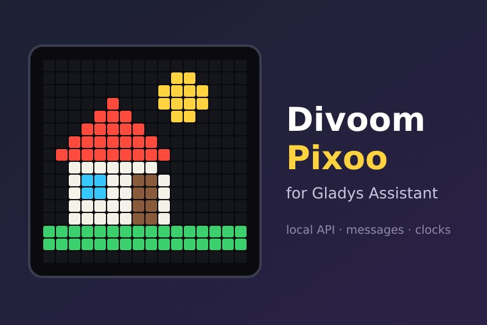
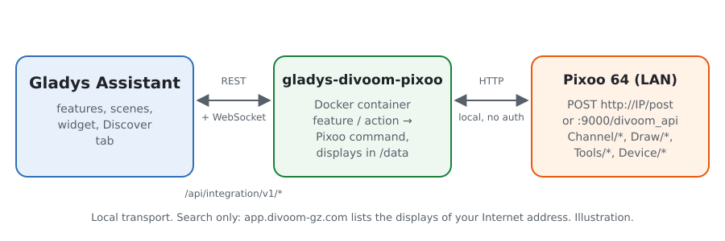
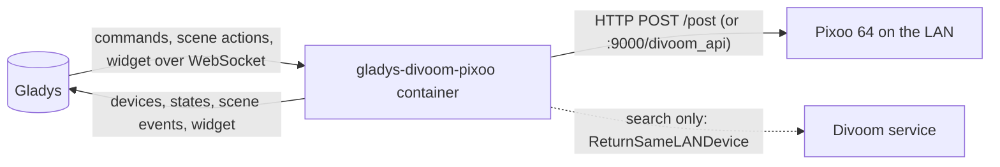
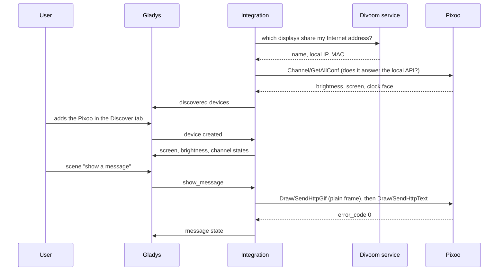
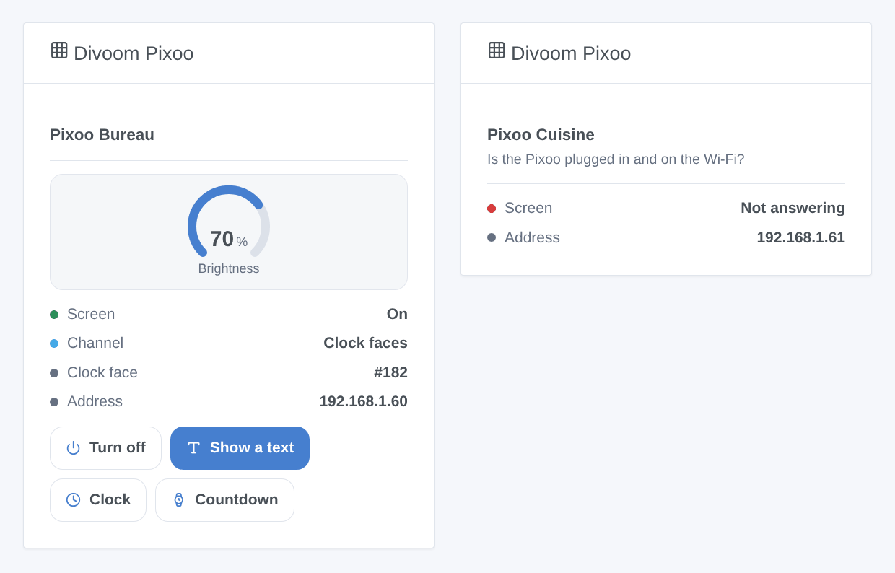

# Gladys Divoom Pixoo

**English** · [Français](README.fr.md) · [Deutsch](README.de.md) · [Español](README.es.md)

[](LICENSE)
[](https://github.com/William-De71/gladys-divoom-pixoo/releases)
[](https://github.com/William-De71/gladys-divoom-pixoo/actions/workflows/release.yml)
[](https://gladysassistant.com)



[Gladys Assistant](https://gladysassistant.com) external integration for the **Divoom Pixoo 64** pixel display, through its official local API. Switch the screen and its brightness from Gladys, show messages, GIFs, clock faces and the tools of the Pixoo from your scenes, and keep an eye on it from the dashboard.

User documentation: [English](docs/en.md) · [Français](docs/fr.md) · [Deutsch](docs/de.md) · [Español](docs/es.md).

Not affiliated with Divoom. **Not tested on a real Pixoo yet**: the requests follow the [official Divoom API documentation](http://doc.divoom-gz.com/web/#/12) and the tests run against fake displays. Feedback welcome.

## Features

- **One Gladys device per Pixoo**: screen on/off and brightness (light category, so "turn off the lights" scenes include it), channel (clock faces, cloud gallery, visualizer, custom) and a text typed on the dashboard shown on the screen.
- **States read back** every 10, 30 or 60 seconds: a change made in the Divoom app or on the device shows up in Gladys.
- **8 scene actions**: show a message (one or two lines, colors, background, scrolling, duration then back to the previous view), play a GIF from an address, show a clock face, countdown, stopwatch, scoreboard, noise meter, buzzer.
- **2 scene triggers**: a Pixoo stops answering, answers again.
- **Dashboard widget**: state, channel, clock face number, brightness, and buttons for the screen, a text, the clock and a countdown.
- **Discovery** through the official Divoom "Find device" service (optional) or typed IP addresses; a display is followed by its MAC address when its IP changes.
- Four languages: English, French, German, Spanish.

## How it works





From the search to a command:



The Pixoo crashes when it gets several requests at once: the requests to one display are queued, one at a time. The frame ids of `Draw/SendHttpGif` restart from 1 past 32, as the firmware stalls when they grow.

### Transport

`transports: ["local"]`: every command and state goes over HTTP on the local network. The Gladys badge of each device shows **local**, or **unreachable** when the Pixoo stops answering. When the Divoom search is on, the integration asks `https://app.divoom-gz.com/Device/ReturnSameLANDevice` (no account, no data sent but the request) for the displays seen from your Internet address, like the Divoom app does; turn it off to use typed addresses only.

## Devices and features

| Feature    | Category / type        | Values                                   | Read back |
| ---------- | ---------------------- | ---------------------------------------- | --------- |
| Screen     | `light` / `binary`     | 0 off, 1 on                              | yes       |
| Brightness | `light` / `brightness` | 0 to 100                                 | yes       |
| Channel    | `text` / `select`      | `faces`, `cloud`, `visualizer`, `custom` | yes       |
| Message    | `text` / `text`        | the last text sent from Gladys           | no        |

## Scenes and widget

| Kind    | Key               | Use                                                                  |
| ------- | ----------------- | -------------------------------------------------------------------- |
| Action  | `show_message`    | one or two lines, color, background, scrolling, duration             |
| Action  | `play_gif`        | a GIF 16, 32 or 64 pixels wide, downloaded by the Pixoo              |
| Action  | `show_clock_face` | a clock face by its number (shown in the widget), or the current one |
| Action  | `countdown`       | start or stop the countdown (minutes, seconds)                       |
| Action  | `stopwatch`       | start, stop or reset the stopwatch                                   |
| Action  | `scoreboard`      | blue and red scores, 0 to 999                                        |
| Action  | `noise_meter`     | start or stop the noise meter                                        |
| Action  | `play_buzzer`     | buzz up to 10 seconds                                                |
| Trigger | `unreachable`     | a Pixoo stopped answering twice in a row                             |
| Trigger | `reachable_again` | it answers again                                                     |
| Widget  | `pixoo`           | one display: state, channel, brightness, four buttons                |

Examples: when the mailbox opens, show "Mail is here" in yellow for 60 seconds; every evening at 11 pm, switch the screen off; when the washing machine is done, show a message on a dark blue background and buzz for one second.



## Requirements

- Gladys Assistant **5.3.0** or later (older versions cannot install the integration).
- A Divoom Pixoo 64 set up with the Divoom app, on the network of Gladys, with an up-to-date firmware. Other Divoom Wi-Fi displays (Pixoo 16, Pixoo Max, Times Gate) may work partly; the Bluetooth speakers (Ditoo, Tivoo…) have no local API and are left out.

## Installation

- **From the store**: Integrations → Divoom Pixoo → Install.
- **From the repository URL**: Integrations → external integration → `https://github.com/William-De71/gladys-divoom-pixoo`.
- **Developer mode**: run `npm start` with the variables given by Gladys (see Development).

## Configuration

| Field                                     | Default    | Use                                                               |
| ----------------------------------------- | ---------- | ----------------------------------------------------------------- |
| Find the displays with the Divoom service | on         | asks the official Divoom service for the displays of your network |
| IP addresses                              | empty      | displays the search does not find, comma-separated                |
| State refresh                             | 30 seconds | 10 s, 30 s or 1 min                                               |
| Language of the device texts              | English    | feature and channel names, scene error messages                   |

The **Search and test the displays** button searches again and lists every Pixoo found with its address and brightness.

## Usage

1. Configure, then click **Search and test the displays**.
2. Open the **Discover** tab and add your displays.
3. Use the features on the dashboard, add the **Divoom Pixoo** widget, and build scenes with the actions and triggers above.

## Development

```bash
npm install
npm test                       # node --test, fake displays, never the network
npm run lint                   # ESLint
npm run format:check           # Prettier
npx github:GladysAssistant/integration-store . --skip-image-check
scripts/build-cover.sh         # cover.jpg from docs/assets/cover.svg
docs/illustrations/render.sh   # docs/assets/widgets.<lang>.png
```

Locally, the SDK reads `GLADYS_HOST_API_URL`, `GLADYS_INTEGRATION_TOKEN` and `GLADYS_INTEGRATION_SELECTOR` (given by Gladys in developer mode); `PIXOO_DATA_DIR` moves `/data`. `DEBUG=gladys-integration-sdk` shows the SDK logs.

The tests cover the HTTP client (documented commands, the :9000 endpoint, one request at a time), the Divoom search, the frames, the device of the Discover tab (pinned in `test/fixtures/discovery.baseline.json`), the widget (`validateWidgetContent`), the manifest, the four languages, the release script, and the whole integration against the fake Gladys of the SDK. `test/structure.test.js` freezes every key users store.

## Release process


Every merge on `main` runs the CI, then computes the version from the [Conventional Commits](https://www.conventionalcommits.org/) since the last tag: `feat` → minor, `fix` / `perf` → patch, `!` or `BREAKING CHANGE` → major (a minor below 1.0.0); `docs`, `chore`, `ci`, `test`, `style`, `refactor`, `build` alone publish nothing. The changelog section is generated, the tag pushed, the multi-architecture image built, then `main` receives the release commit, the GitHub Release is created and a last job checks the public image, the store validator and the topic.

- The pull request title becomes the squash commit, then the changelog line: write it in English, for the user (`pr-title.yml` checks it). Never edit `CHANGELOG.md` by hand.
- 1.0.0 is a decision: Actions → Release → Run workflow with `release-as: 1.0.0`. `dry-run` shows the version and the notes without publishing.
- **Protected branch**: the release pushes its commit to `main` with `GITHUB_TOKEN`. The `protect-main` ruleset (no deletion, no force-push) lets it through; a stricter rule (pull request required, status checks) would need GitHub Actions in its bypass list, or a GitHub App.
- After the first release, make the `ghcr.io` package public (Package settings → Change visibility), or Gladys cannot pull it.

## Troubleshooting

See [docs/en.md](docs/en.md#troubleshooting). Report issues with the versions of Gladys, of the integration and of the Pixoo firmware, and the message of **Search and test the displays**.

## Contributing

Issues and pull requests are welcome, especially from Pixoo owners: the result of a real display (what works, what does not) helps a lot. Run `npm run format:check && npm run lint && npm test` before opening a pull request, and keep every stored key unchanged (see [CLAUDE.md](CLAUDE.md)).

## Security

See [SECURITY.md](SECURITY.md): report vulnerabilities privately. The local API of the Pixoo has no password: keep it on a trusted network.

## Screenshots to come

The images above are illustrations, not screenshots. Real screenshots will go in `docs/assets/screenshots/` (PNG, 1280 × 800): `configuration.png` (the configuration with its status), `discover.png` (a Pixoo in the Discover tab), `dashboard.png` (the features and the widget on a dashboard), `pixoo-message.jpg` (a photo of a message on the Pixoo).

## License

[Apache License 2.0](LICENSE) — see also [NOTICE](NOTICE). Divoom and Pixoo are trademarks of Divoom; this project is not affiliated with, endorsed or sponsored by Divoom. Thanks to the Gladys documentation and SDK, to the official Divoom API documentation, and to the Home Assistant integration [pixoo-homeassistant](https://github.com/gickowtf/pixoo-homeassistant) for its observations of the firmware.
