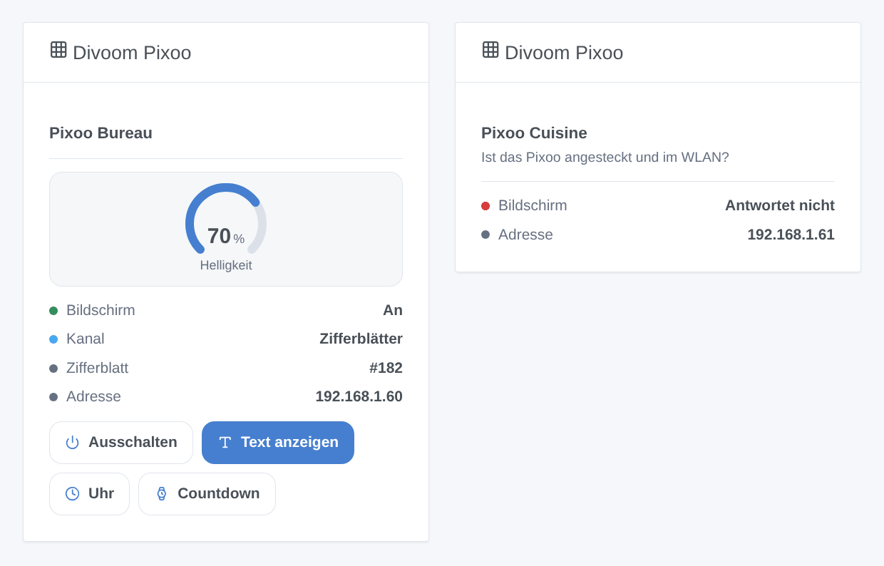

# Divoom Pixoo

## Überblick

Diese Integration steuert das Pixel-Display **Divoom Pixoo 64** aus Gladys, über seine offizielle lokale API (HTTP im lokalen Netzwerk, kein Konto, keine Kopplung). Jedes Pixoo wird ein Gladys-Gerät: Bildschirm an/aus, Helligkeit, Kanal und ein Text auf dem Bildschirm. Szenenaktionen zeigen Nachrichten, GIFs, Zifferblätter und die Tools des Pixoo (Countdown, Stoppuhr, Anzeigetafel, Lärmmesser, Summer); ein Dashboard-Widget fasst das Wichtigste zusammen.

Befehle und Zustände bleiben im lokalen Netzwerk. Nur die Suche kann den offiziellen Divoom-Dienst fragen, welche Displays sich von deiner Internetadresse aus verbinden, wie es die Divoom-App tut (abschaltbar). Nicht mit Divoom verbunden. **Noch nicht an einem echten Pixoo getestet**: Die Anfragen folgen der offiziellen Divoom-Dokumentation; Rückmeldungen sind willkommen.

## Voraussetzungen

- Gladys Assistant 5.3.0 oder neuer.
- Ein Divoom Pixoo 64, eingerichtet mit der Divoom-App, im selben Netzwerk wie Gladys (kein Gastnetz), mit aktueller Firmware. Andere WLAN-Displays von Divoom können teilweise funktionieren.
- Am besten eine feste IP-Adresse für das Pixoo im Router.

## Konfiguration

1. Installiere die Integration aus dem Store und öffne ihre Konfiguration.
2. Lass **Displays über den Divoom-Dienst finden** eingeschaltet, oder schalte es aus und gib die IP-Adressen deiner Displays ein (durch Kommas getrennt).
3. Wähle die **Zustandsaktualisierung** (standardmäßig 30 Sekunden) und die **Sprache der Gerätetexte**.
4. Klicke auf **Displays suchen und testen**: Die Meldung listet jedes gefundene Pixoo mit Adresse und Helligkeit auf.
5. Öffne den Tab **Entdecken** und füge deine Displays hinzu.

## Verwendung

Jedes Pixoo hat vier Funktionen:

| Funktion   | Typ              | Was sie tut                                                                        |
| ---------- | ---------------- | ---------------------------------------------------------------------------------- |
| Bildschirm | Licht, an/aus    | Schaltet den Bildschirm ein oder aus (eine Szene „Licht aus“ tut es auch)          |
| Helligkeit | Licht, 0 bis 100 | Helligkeit des Bildschirms                                                         |
| Kanal      | Liste            | Zifferblätter, Cloud-Galerie, Visualizer oder Benutzerdefiniert                    |
| Nachricht  | Text             | Gib im Dashboard einen Text ein: Er erscheint auf dem Bildschirm, weiß auf schwarz |

Änderungen am Gerät oder in der Divoom-App werden bei der nächsten Aktualisierung gelesen.

### Dashboard-Widget

Das Widget **Divoom Pixoo** zeigt ein Display: Bildschirm, Kanal, Nummer des aktuellen Zifferblatts, Adresse und Helligkeit, mit vier Tasten: Bildschirm ein- oder ausschalten, **Text anzeigen** (Text, Farbe, Dauer), **Uhr** und **Countdown** (Minuten).

### Szenen

Aktionen: **Nachricht anzeigen** (eine oder zwei Zeilen, Textfarbe, Hintergrund, Laufgeschwindigkeit, Dauer: 0 lässt sie stehen, sonst kehrt das Pixoo zur vorherigen Anzeige zurück), **GIF abspielen** (Adresse eines GIFs mit 16, 32 oder 64 Pixel Breite, vom Pixoo selbst geladen), **Zifferblatt anzeigen** (seine Nummer zeigt das Widget, sobald du es in der Divoom-App gewählt hast), **Countdown**, **Stoppuhr**, **Anzeigetafel**, **Lärmmesser** und **Summen** (höchstens 10 Sekunden).

Auslöser: **Pixoo: antwortet nicht mehr** (zweimal hintereinander) und **Pixoo: antwortet wieder**, mit Gerätename und Adresse als Variablen.

Beispiele:

- Wenn der Briefkastensensor öffnet → „Post ist da“ 60 Sekunden lang in Gelb anzeigen.
- Jeden Abend um 23 Uhr → Bildschirm aus; um 7 Uhr → einschalten und das Zifferblatt zeigen.
- Wenn die Waschmaschine fertig ist → „Wäsche fertig“ auf dunkelblauem Hintergrund zeigen und 1 Sekunde summen.

## Fehlerbehebung

- **Kein Pixoo gefunden**: Prüfe, ob es angeschlossen und im selben Netzwerk wie Gladys ist, gib dann seine Adresse (Divoom-App → Geräteeinstellungen) in der Konfiguration ein und nutze **Displays suchen und testen**. Die Divoom-Suche funktioniert nicht hinter einem VPN oder mit mehreren Internetanschlüssen.
- **„hat den Befehl abgelehnt“**: Die Firmware ist vermutlich zu alt für diesen Befehl; aktualisiere sie in der Divoom-App.
- **Ein GIF startet nicht**: Das Pixoo lädt es selbst und nimmt nur GIFs mit 16, 32 oder 64 Pixel Breite; einfaches http funktioniert am besten.
- Für einen Fehlerbericht nenne die Versionen von Gladys und der Integration, die Meldung der Testtaste und die Logs (füge im Entwicklermodus `DEBUG=gladys-integration-sdk` hinzu): [Issue eröffnen](https://github.com/William-De71/gladys-divoom-pixoo/issues).
