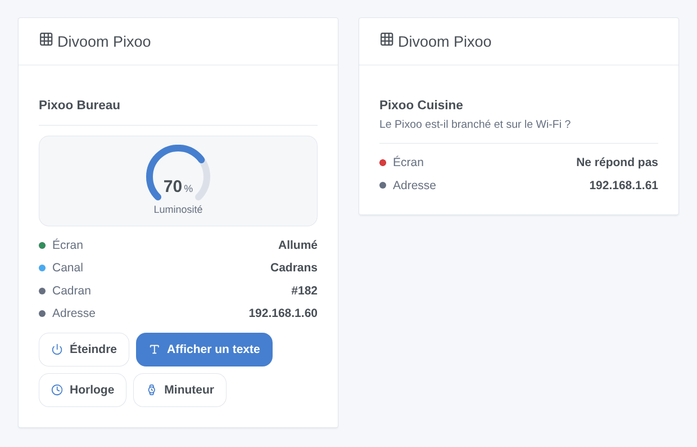

# Divoom Pixoo

## Présentation

Cette intégration pilote l’écran à pixels **Divoom Pixoo 64** depuis Gladys, par son API locale officielle (HTTP sur le réseau local, ni compte ni appairage). Chaque Pixoo devient un appareil Gladys : écran allumé/éteint, luminosité, canal et un texte affiché à l’écran. Des actions de scène affichent des messages, des GIF, des cadrans et les outils du Pixoo (minuteur, chronomètre, tableau des scores, sonomètre, buzzer) ; un widget de tableau de bord réunit l’essentiel.

Commandes et états restent sur le réseau local. Seule la recherche peut demander au service officiel Divoom quels écrans se connectent depuis votre adresse Internet, comme le fait l’appli Divoom (désactivable). Sans lien avec Divoom. **Pas encore testée sur un vrai Pixoo** : les requêtes suivent la documentation officielle de Divoom ; vos retours sont les bienvenus.

## Prérequis

- Gladys Assistant 5.3.0 ou plus récent.
- Un Divoom Pixoo 64 installé avec l’appli Divoom, sur le même réseau que Gladys (pas un réseau invité), avec un micrologiciel à jour. D’autres écrans Wi-Fi Divoom peuvent fonctionner en partie.
- Idéalement, une adresse IP fixe pour le Pixoo dans votre box.

## Configuration

1. Installez l’intégration depuis le store, puis ouvrez sa configuration.
2. Laissez **Trouver les écrans avec le service Divoom** activé, ou désactivez-le et saisissez les adresses IP de vos écrans (séparées par des virgules).
3. Choisissez l’**actualisation de l’état** (30 secondes par défaut) et la **langue des textes des appareils**.
4. Cliquez sur **Rechercher et tester les écrans** : le message liste chaque Pixoo trouvé, avec son adresse et sa luminosité.
5. Ouvrez l’onglet **Découverte** et ajoutez vos écrans.

## Utilisation

Chaque Pixoo a quatre fonctionnalités :

| Fonctionnalité | Type                  | Ce qu’elle fait                                                                |
| -------------- | --------------------- | ------------------------------------------------------------------------------ |
| Écran          | lumière, marche/arrêt | Allume ou éteint l’écran (une scène « éteindre les lumières » le fait aussi)   |
| Luminosité     | lumière, 0 à 100      | Luminosité de l’écran                                                          |
| Canal          | liste                 | Cadrans, Galerie cloud, Visualiseur ou Personnalisé                            |
| Message        | texte                 | Tapez un texte sur le tableau de bord : il s’affiche à l’écran, blanc sur noir |

Les changements faits sur l’appareil ou dans l’appli Divoom sont relus à l’actualisation suivante.

### Widget de tableau de bord

Le widget **Divoom Pixoo** montre un écran : état, canal, numéro du cadran en cours, adresse et luminosité, avec quatre boutons : allumer ou éteindre l’écran, **Afficher un texte** (texte, couleur, durée), **Horloge** et **Minuteur** (minutes).

### Scènes

Actions : **Afficher un message** (une ou deux lignes, couleur du texte, fond, défilement, durée : 0 le garde, sinon le Pixoo revient à ce qu’il affichait), **Lire un GIF** (adresse d’un GIF de 16, 32 ou 64 pixels de large, téléchargé par le Pixoo lui-même), **Afficher un cadran** (son numéro apparaît dans le widget une fois choisi dans l’appli Divoom), **Minuteur**, **Chronomètre**, **Tableau des scores**, **Sonomètre** et **Faire sonner** (10 secondes au plus).

Déclencheurs : **Pixoo : ne répond plus** (deux fois de suite) et **Pixoo : répond de nouveau**, avec le nom et l’adresse de l’appareil en variables.

Exemples :

- Quand le capteur de la boîte aux lettres s’ouvre → afficher « Le courrier est là » en jaune pendant 60 secondes.
- Chaque soir à 23 h → éteindre l’écran ; à 7 h → l’allumer et afficher le cadran.
- Quand la machine à laver a fini → afficher « Lessive finie » sur fond bleu foncé et faire sonner 1 seconde.

## Dépannage

- **Aucun Pixoo trouvé** : vérifiez qu’il est branché et sur le même réseau que Gladys, puis saisissez son adresse (appli Divoom → réglages de l’appareil) dans la configuration et utilisez **Rechercher et tester les écrans**. La recherche Divoom ne marche pas derrière un VPN ou avec plusieurs connexions Internet.
- **« a refusé la commande »** : le micrologiciel est sans doute trop ancien pour cette commande ; mettez-le à jour dans l’appli Divoom.
- **Un GIF ne se lance pas** : le Pixoo le télécharge lui-même et n’accepte que des GIF de 16, 32 ou 64 pixels de large ; le http simple marche le mieux.
- Pour signaler un problème, donnez les versions de Gladys et de l’intégration, le message du bouton de test et les journaux (ajoutez `DEBUG=gladys-integration-sdk` en mode développeur) : [ouvrir une issue](https://github.com/William-De71/gladys-divoom-pixoo/issues).
